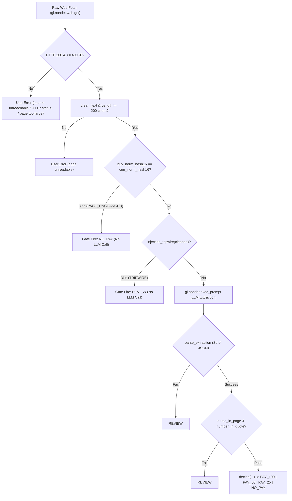

# Architecture and Consensus Design: Cover

This document specifies the technical architecture, consensus model, security invariants, and failure handling of **Cover**.

---

## 1. Why GenLayer Validators Compare `<OUTCOME>|<norm_hash16>`

In GenLayer, validators independently execute non-deterministic actions (web fetching and LLM calls) before reaching state transition consensus.

### The Problem with Rich LLM Outputs:
When multiple validator nodes query an LLM on free text, minor syntactic variations inevitably occur:
- Validator A may extract quote `"Status: Major outage. Duration: 75 minutes."`
- Validator B may extract quote `"Duration: 75 minutes."`
- Validator C may include or omit surrounding punctuation or markdown tokens.

Comparing raw JSON objects containing free text quotes or explanations leads to spurious consensus disagreement (`MAJORITY_DISAGREE`), aborting valid state updates.

### The Consensus Primitive:
Cover implements the leader/validator pattern via `gl.vm.run_nondet(leader_fn, validator_fn)`:
- **Leader Function**: The leader fetches the status page, normalizes the text, executes input gates (byte limits, minimum length, unchanged page, injection tripwires), invokes the LLM prompt, strictly parses the output JSON, verifies quote containment, computes the payout decision via `decide(...)`, and constructs a complete observation package including full quote and extracted minutes.
- **Consensus Token**:
  - `settle`: `"<OUTCOME>|<norm_hash16>"`, where `OUTCOME` is strictly one of `PAY_100`, `PAY_50`, `PAY_25`, `NO_PAY`, or `REVIEW`, and `norm_hash16` is the first 16 characters of `sha256(norm_text(page))`.
  - `buy`: `"OPERATIONAL|<norm_hash16>"` or `"NOT_OPERATIONAL|<norm_hash16>"`.
- **Validator Function**: The validator re-fetches the page independently, re-runs the identical deterministic cleaning and decision pipeline, and checks ONLY that its re-computed `consensus_token` matches the leader's token.

### What is Left Out of Consensus:
- Extracted quote string (leader-reported, informational).
- Leader's exact LLM reasoning or whitespace.
- Stated duration minutes (validated locally by validator code; the resulting bracketed outcome is what enters the token).

This guarantees deterministic agreement while keeping all payout calculations strictly bound to validator-verified page text.

---

## 2. Multi-Layer Defensive Pipeline

---

## 3. Storage Architecture and Canonical Encoding

All persistent contract state is stored in `TreeMap[str, str]` containing sorted, canonical JSON with `"schema_version": "1"`. Decimal strings represent all numeric balances and counters.

### Schemas:
1. `products[product_id]`:
   - `id`, `creator`, `name`, `url`, `host`, `dir_path`, `rule_text`, `min_full`, `min_half`, `premium_bps`, `terms_hash`, `pool_balance`, `reserved`, `policy_count`, `source_history`, `seq`.
2. `policies[policy_id]`:
   - `id`, `product_id`, `holder`, `coverage`, `premium`, `status` (`ACTIVE` | `PAID` | `CANCELLED`), `buy_norm_hash16`, `paid_amount`, `attempts`, `seq`.
3. `settlements[settlement_id]`:
   - `id`, `policy_id`, `caller`, `url_used`, `outcome`, `norm_hash16`, `status`, `minutes`, `quote`, `gate`, `tripwire`, `leader_reported`, `seq`.
4. `seen`:
   - `sha256(policy_id|norm_hash16)` -> `settlement_id`. Rejects duplicate settlement attempts on the exact same page state.

---

## 4. Solvency and Conservation Invariants

Cover enforces three mathematical invariants across all state mutations (`claim_demo_credits`, `fund_product`, `buy`, `settle`, `cancel`, `withdraw_unreserved`):

1. **Global Conservation of Credits**:
   $$\sum \text{balances} + \sum \text{pool\_balance} = \text{total\_minted}$$
2. **Product Solvency**:
   $$\forall p \in \text{products}, \quad \text{reserved}_p \le \text{pool\_balance}_p$$
3. **Coverage Reservation Equality**:
   $$\forall p \in \text{products}, \quad \text{reserved}_p = \sum_{pol \in \text{ACTIVE}(p)} \text{coverage}_{pol}$$
